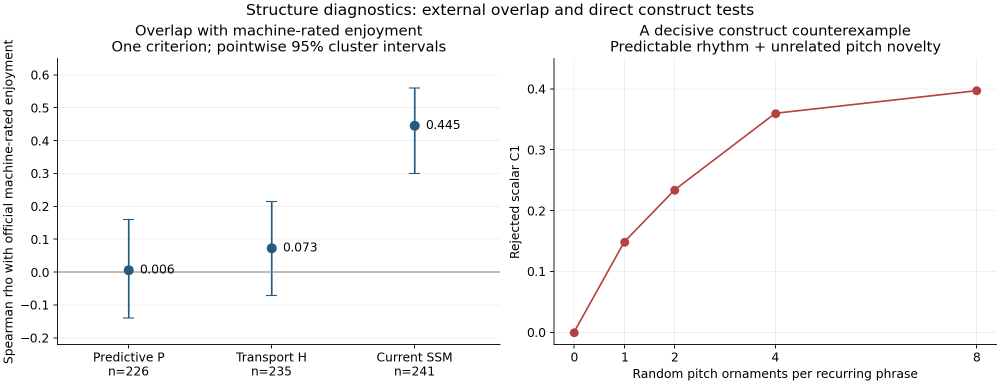
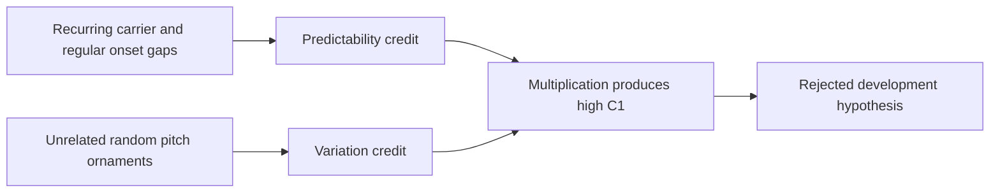
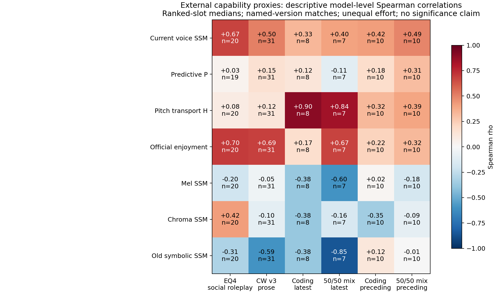
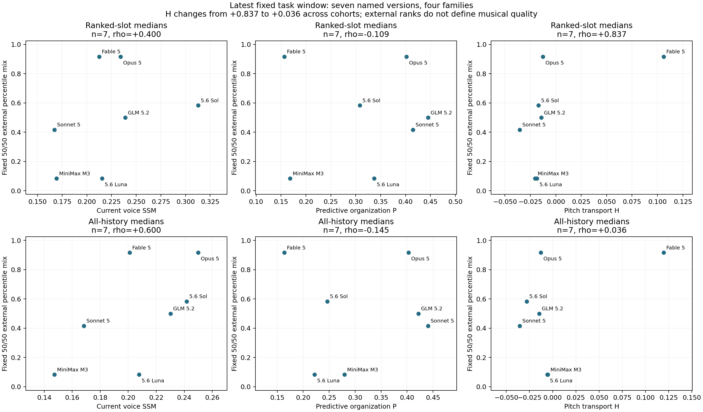
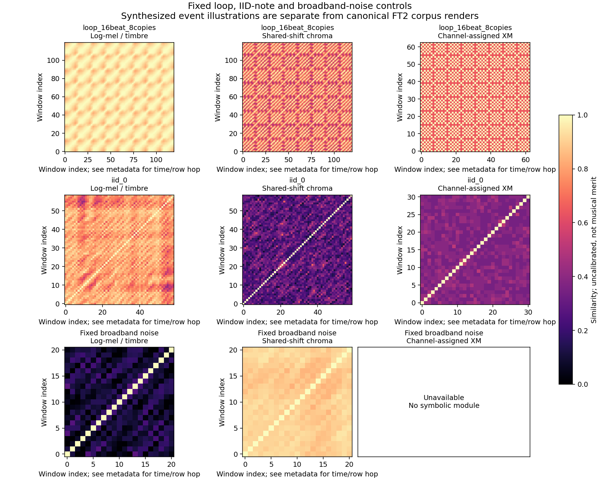
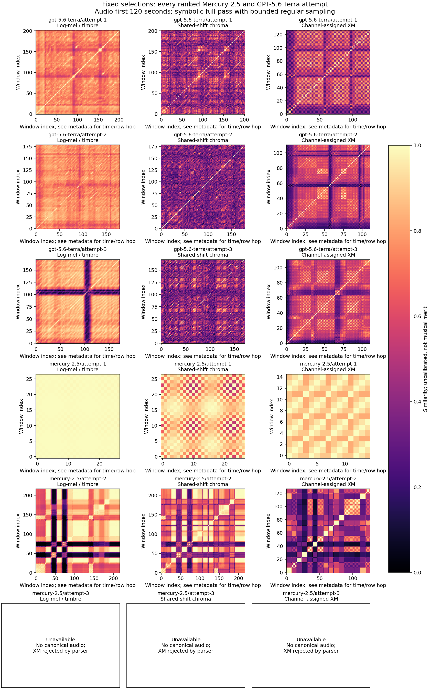

# Structure diagnostics study

**Can a music benchmark distinguish repetition, development and noise?** We
added two explicit tests, challenged them with synthetic counterexamples, and
checked them against the current benchmark and archived attempts. The result
is a measurement toolkit, reproducible counterexamples, and evidence about
which claims the proposed descriptors can support.

This is a research fork of [Microck/keygen-bench](https://github.com/Microck/keygen-bench),
using upstream snapshot
[`da00c48`](https://github.com/Microck/keygen-bench/tree/da00c48e28cd722a54ff335f4d432d07fdeadbc7).
The original benchmark, credits, archived runs and production scorer are
preserved. Audiobox enjoyment is a machine prediction, not human ground truth.

The intended question is whether a structure metric adds a useful, distinct
dimension. Predicting enjoyment is only one comparison, not its required target.
Low correlation can indicate a separate construct or an unreliable measurement;
high correlation can indicate shared signal without complete redundancy. Neither
decides usefulness alone. The **.445** below belongs to the current upstream
voice SSM, not the newly proposed P/H diagnostics or the earlier three SSM views.
The [external comparison](external/results.md) uses fixed equal roleplay/coding
weights, reports both components and creative writing separately, and preserves
the formulas without tuning them to leaderboard results.



## What survived the investigation

| Question | Result |
| --- | --- |
| Can we measure sequential order and pitch-set movement reproducibly? | Yes: prequential coding **P** and circular pitch-set transport **H** match independent numerical references. |
| Does their proposed organization × variation score work? | **No.** Random ornaments on a predictable carrier defeat C1/C2. Twelve of 76 independently specified gates failed. |
| How much do they overlap machine-rated enjoyment? | P: rho **.006**; H: **.073**; current voice SSM: **.445**. Enjoyment is one comparison criterion. The separate held-out prediction test found no reliable gain; this does not decide structural usefulness. |
| Do external roleplay and coding results support an added metric? | **No robust added benefit established.** Current SSM correlates **.672** with conversational roleplay and **.501** with creative writing. H's **.837** against the seven-model 50/50 mix falls to **.036** with historical runs. [All components and sensitivities](external/results.md). |
| Does the requested 132→131.999 perturbation cause a large audio-SSM jump? | No in the two measured examples. Window phase and context changes mattered much more. |
| Is the historical archive represented? | **730** attempt records, including **460** historical/other records; **409** available canonical renders. Missing artifacts remain missing. |
| What is available to reuse? | Offline CLI, fixed formulas, **32** standalone tests, **24** existing baseline tests, a **57**-fixture reproducible subset, compact tables and graph gallery. |

The larger archived validation used **246 frozen fixtures**, including all
tested 8–20-channel equivalences and global transpositions. Those original
full-study counts are reported provenance; the shipped fixture command
reproduces the explicitly identified 57-case subset, not the entire study.
Formulas and test requirements were frozen prospectively within the project;
this was **not an externally registered study**.

The clearest immediate contribution is the controlled test battery: it can
detect loop-boundary artifacts, novelty supplied by unrelated ornaments, and
changes caused by equivalent tempo/channel representations. Those are concrete
regression checks even while an additional overall score remains unvalidated.

## Why the scalar failed

The proposed C1 multiplied predictive organization, window variation and an
exact short-loop guard. It let one part of the music supply regularity while
unrelated notes supplied novelty. Eight random ornaments per phrase raised C1
to **0.396845**. Current upstream's per-voice SSM gave that same nominal-event
fixture **0.012355**. Different score scales prevent absolute calibration
claims, but this is a clear challenge the new proposal failed.



An exact 16-beat loop gives C1=0; one silent trailing tick raises it to .029163.
An exact 17-beat block escapes the guard, and adding copies initially raises
its score. These are retained counterexamples, not repaired after viewing
enjoyment results. [Methods and detailed results](methods-and-results.md).

## External capability comparison

We froze the matching and aggregation rules before joining external scores to
music features. Each named model version contributes its median available music
descriptor; historical attempts form a separate sensitivity. The mix averages
the two percentile ranks with fixed 50/50 weights. EQ-Bench 4 measures simulated
social/emotional roleplay; Creative Writing v3 measures prose; SWE-rebench supplies
a common coding agent on fixed task windows. None is a musical-quality standard.



The strongest new H association depends heavily on which music runs are
included. Seven matched versions from four families are too few to establish
reliable added value. Exact named-release matching also cannot guarantee
identical weights or provider behavior across evaluations. Known model redirects
and unchanged-name upgrades were excluded before inspecting correlations.



[Detailed findings](external/results.md) · [Frozen analysis rules](external/protocol.md) ·
[Reproduce the external comparison](external/analyze_external_proxy.py)

## Read the matrices, then listen

Each view asks a different question: mel emphasizes spectral texture, chroma
pitch-class recurrence, and symbolic matching event shapes. Brightness is not
musical quality. A stationary noise texture can look recurrent too.



The original Mercury and Terra examples were kept fixed, with every ranked
slot visible rather than selecting a favorable attempt. The chart shows
missing/invalid slots explicitly.



[Terra attempt 2 in detail](figures/gpt-5.6-terra--attempt-2--three-ssm.png) ·
[Mercury attempt 1 in detail](figures/mercury-2.5--attempt-1--three-ssm.png) ·
[Tempo/window figure](figures/audio-stability.png) ·
[Full association intervals](figures/correlations.png)

## A small historical listening queue

These four examples are an illustrative subset of the prespecified retrospective
shortlist from the pinned public archive, chosen for
metric disagreement or high **local model-predicted CE**. They are invitations
to listen, not discoveries of objectively overlooked quality. Historical
conditions differ. Local ratings are kept separate from the official labels;
the symbolic values remain nominal when timing support is limited.

| Historical attempt | Local CE / 10 | Why listen? |
| --- | ---: | --- |
| [Muse Spark 1.3, historical repetition 3](https://raw.githubusercontent.com/Microck/keygen-bench/da00c48e28cd722a54ff335f4d432d07fdeadbc7/runs/muse-spark-1.3-contributor/other/2026-10-01-go-muse-spark-1.3-contributor-rep-3/canonical/canonical.wav.flac) | 6.759 | High CE percentile relative to current SSM. |
| [Claude Fable 5.1, historical attempt](https://raw.githubusercontent.com/Microck/keygen-bench/da00c48e28cd722a54ff335f4d432d07fdeadbc7/runs/claude-fable-5.1/other/2026-09-27-claude-fable-5-1-2/canonical/canonical.wav.flac) | 6.903 | High CE despite very low rejected C1; strict timing unsupported. |
| [GPT 6.1 Sol, historical attempt](https://raw.githubusercontent.com/Microck/keygen-bench/da00c48e28cd722a54ff335f4d432d07fdeadbc7/runs/gpt-6.1-sol/other/2026-09-29-gpt-6.1-sol/canonical/canonical.wav.flac) | 7.040 | Another CE/C1 disagreement; strict timing unsupported. |
| [DeepSeek V4 Pro, historical attempt 2](https://raw.githubusercontent.com/Microck/keygen-bench/da00c48e28cd722a54ff335f4d432d07fdeadbc7/runs/deepseek-v4-pro/other/2026-09-25-devin-deepseek-v4-pro-2/canonical/canonical.wav.flac) | 7.139 | Among the higher historical local-CE observations. |

Links pin the public source commit. [Selected rows and audio blob identities](data/selected-listening.csv)
retain the selection rule and timing flag. Audio is linked, not redistributed
as a new dataset here; original contributor/sample rights still apply.

## Run the useful part

From the repository root, Python 3.11+ and its standard library suffice:

```sh
python -m unittest discover -s scripts/diagnostics/tests -v
python -m unittest benchmark.tests.test_score_structure -v
python scripts/diagnostics/analyze_structure.py --root . --xm tune.xm --out diagnostics.json
python scripts/diagnostics/run_fixtures.py --upstream-root . --out fixtures.json
```

These commands make no paid model calls and require no renderer or Docker.
They reproduce core descriptors and the small synthetic battery. The larger
corpus study and source SSM plots are archived result snapshots. A minimal
association reproducer additionally ships with the allowlisted 730-row input;
it needs NumPy/SciPy and verifies all 12 official P/H/current-SSM correlations
and clustered intervals across full/prefix and row-start/strict analyses:

```sh
python docs/research/structure-study/reproduce_associations.py --check --out reproduced.json
```

This compact showcase does not ship the full corpus acquisition, audio-SSM,
listener-inference or held-out regression pipeline.

The complete external comparison is separately reproducible from its saved
inputs with NumPy, SciPy, pandas and Matplotlib:

```sh
python docs/research/structure-study/external/analyze_external_proxy.py --data docs/research/structure-study/external
```

[Technical guide](../../structure-diagnostics.md) ·
[Methods/results and limitations](methods-and-results.md) ·
[Public data dictionary and provenance](data/README.md) ·
[Reproduce the primary associations](reproduce_associations.py) ·
[Plot this overview from the public tables](plot_summary.py) ·
[Upstream notices](../../../NOTICE.md)
