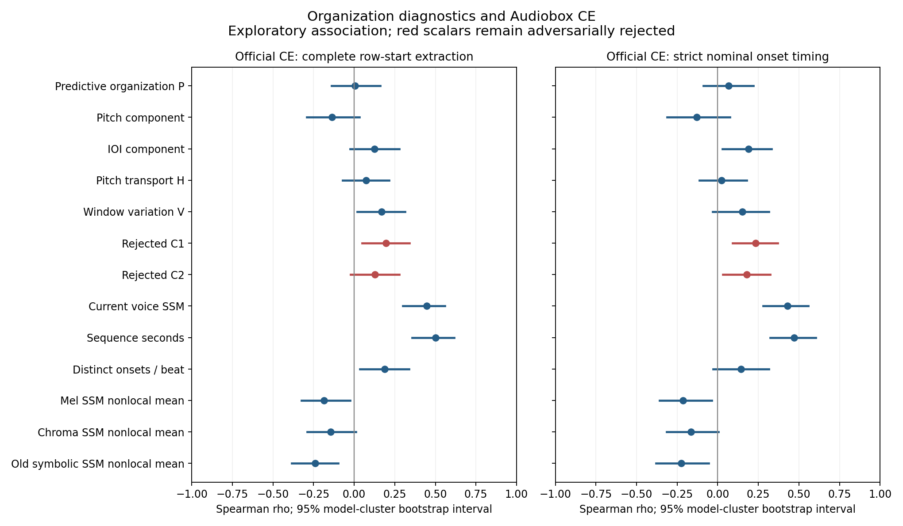
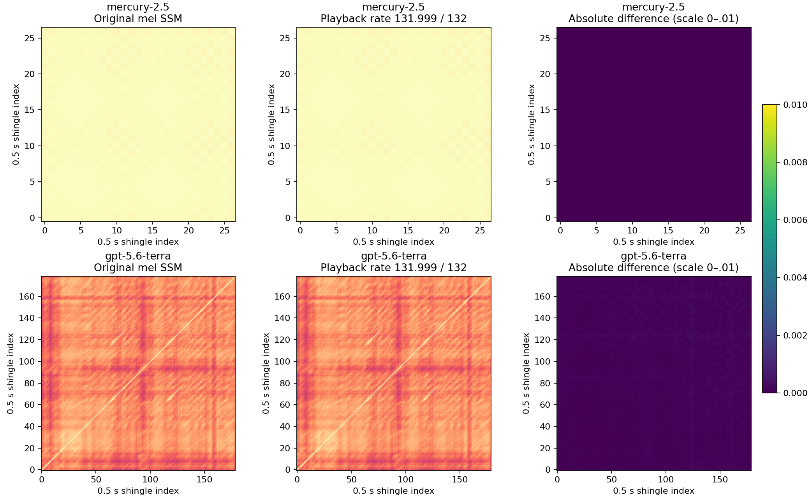

# Methods, results and scope

## What would count as an additional useful metric?

The intended contribution is a distinct, interpretable description of musical
organization. Its first requirements are valid responses to controlled changes,
stability under irrelevant transformations, and reproducible measurement.
Relationships with enjoyment, conversational roleplay and coding ability supply
external evidence about overlap and possible general capability; none defines
the correct musical score. Low correlation alone does not prove independence
or usefulness, and high correlation alone does not prove redundancy.

The C1/C2 counterexamples below reject those formulas' proposed development
interpretation directly. P and H remain narrower descriptors. Establishing that
either improves a practical benchmark decision requires a specified use and
validation beyond these descriptive correlations.

## Two distinct constructs

The diagnostic API converts simultaneous eligible nominal onsets to sets of
pitch classes on the traversed tracker speed clock, 24 ticks per conventional
beat. It removes first-onset offset, channel identity, duplicate classes and
register. BPM metadata does not enter the formulas. The adapter uses the
upstream parser/traverser and records their hashes and effect coverage.

**P: prequential predictive organization.** Pitch-set labels and positive
inter-onset gaps are coded separately. A Bayesian mixture of context orders
0, 1, 2, 4 and 8 predicts each symbol before updating, against the same observed
prefix. Eight deterministic controls shuffle pitch labels within tick-modulo-24
groups and gaps globally. P averages positive normalized coding gains after
subtracting median control gains. Gaps above 385 ticks share an overflow token.
These controls supply an effect-size reference, not a calibrated p-value.

**H: ordered pitch-set transport.** Uniform mass on each onset's pitch classes
moves to the next set using circular semitone distance divided by six. Exact
Wasserstein cost handles unequal cardinalities. H compares mean adjacent
transport with those same pitch shuffles; it is signed and excluded from C1/C2.
In monophonic material it describes melodic step economy, not harmony.

The [exact frozen specification](../../../scripts/diagnostics/structure_spec.json)
and [implementation](../../../scripts/diagnostics/structure_diagnostics.py)
define smoothing, mixture updates, scales, seed and eligibility. Their method
ID contains `preregistered` as an immutable historical identifier; it denotes an
internal prospective freeze, **not external registration**. API revision 1.0.1
fixes incomplete-extraction eligibility and CLI failure status without changing
formulas or specification bytes.

## Validation and the rejected scalar

The archived independent battery contained 246 fixtures and 76 explicit gates:
64 passed, 12 failed. All 34 event-domain invariance checks passed, as did 17
native-XM extraction equivalences. Independent rational code likelihoods
agreed across 80 references (maximum loss discrepancy 8.53e-14); independent
min-cost-flow transport agreed across 300 pitch-set pairs (maximum 1.67e-16).
These archived checks are distinct from the shipped 32 software tests and the
57 reproducible synthetic cases.

Both frozen candidates failed the broad developing-music target. C1 was
`P*V*G`; C2 used `P*sqrt(V)*G`. V counts distinct nonempty complete 96/192-tick
windows at two origins. G rejects only exact whole-timeline periods at most
384 ticks repeated at least three times. Neither enters production scoring.

| Counterexample | Observed C1 |
| --- | ---: |
| Exact 16-beat block repeated eight times | 0 |
| Same onsets plus one silent trailing tick | .029163 |
| Same loop with one changed pitch | .037820 |
| Exact 17-beat block, two / three / four copies | .230579 / .287108 / .320994 |
| Carrier plus zero / one / two / four / eight random ornaments | 0 / .148510 / .233927 / .359769 / .396845 |

The shipped fixture runner retains these inputs and raw outputs and compares
current `_development` on the same nominal-event clock. It explicitly flags
same-channel simultaneous events as not native-equivalent. This exploratory
comparison was run after candidate falsification, so it is not a prospectively
frozen competition. Current per-voice SSM gave the eight-ornament case .012355,
handling that challenge substantially better. Methods have different scales.

## Corpus and listener provenance

The pinned public tree contains 730 attempt records: 270 ranked slots across
90 model directories and 460 historical/other attempts. There are 99 model
directories including historical-only ones. Of 415 canonical modules, 410
parsed successfully; five parser rejections remain unavailable. All 409
canonical renders were resolved and decoded. Audio SSMs cover 407; two are too
short. This is the complete attempt census at the chosen snapshot, not a
reconstruction of deleted musical files from repository history.

The primary enjoyment comparison uses **241 official hash-linked CE labels**. Local
inference rated all 409 canonical renders, adding 168 previously unlabeled
renders, including 165 historical attempts. Official and local labels never
fill each other's missingness. Matching uses profile/module/audio provenance.
Across the 241 overlaps, local GPU versus official CE maximum difference was
5.96046448e-6, mean absolute difference 2.42919843e-6, Spearman .999997428.
Twelve fixed CPU anchors supplied an additional arithmetic check.

The listener is
[`facebook/audiobox-aesthetics`](https://github.com/facebookresearch/audiobox-aesthetics),
model revision `9b1dd8e5df9af7216e836a98974fe3b82c56ded6`, weights SHA-256
`a5a3c2412649cc2384ec525ffd5180ce6c4778f43bed6108e0a1303de04d014e`.
Canonical signed-16 PCM was decoded from FLAC, divided by 32768, restricted to
120 seconds, and processed by the package's resampling, mono reduction,
ten-second windows and duration-weighted aggregation. Local runtime was
Python 3.13.5, torch/torchaudio 2.7.1+cu128, package 0.0.4, float32 GPU with TF32
disabled. Official CPU inference used a different runtime. Compatibility on
this overlap is not universal bitwise or human-rating equivalence.

## Association and held-out results

This section answers the narrower question of association with machine-rated
enjoyment. Its held-out model tests added enjoyment prediction only; it does not
test whether a structurally meaningful separate metric should exist.

Intervals use 2,000 **model-directory cluster bootstrap** replicates and are
pointwise, not simultaneous discovery intervals. Repeated attempts stay in
their model cluster. This does not eliminate related-model or campaign
dependence. Official complete row-start and stricter nominal-timing cohorts
are shown separately. Feature-specific complete cases differ:

| Full-song feature / official complete row-start cohort | n / models | Spearman rho [95% interval] |
| --- | ---: | --- |
| P | 226 / 80 | .006 [−.140, .159] |
| H | 235 / 84 | .073 [−.072, .215] |
| Current voice SSM | 241 / 85 | .445 [.301, .560] |
| Sequence duration | 241 / 85 | .503 [.358, .616] |



The fixed baseline linear predictor used current SSM, log1p(duration) and
log1p(onset density); the augmented model added P/H together. Standardization
fit only training folds. The model formula was fixed in advance; ordinary
least-squares coefficients fit CE only on training folds, with no model
selection or hyperparameter tuning. Model-held-out primary RMSE changed
**1.352→1.349**; equal-model MSE
improvement was **.019 [−.090, .124]**. Strict nominal timing worsened RMSE
**1.344→1.352**, with improvement **−.018 [−.103, .061]**. Matched first-120-second
complete-row sensitivity reached the same practical conclusion.

Prefix-family holdouts use recorded model-name prefixes, not an independently
collected external corpus. Intervals on held-out improvement bootstrap fixed
cross-fitted model-level errors; they omit retraining uncertainty. Pooled RMSE
and equal-model improvement have different weights. Two of 16
cohort/horizon/grouping comparisons had barely positive pointwise lower endpoints (.0001345 and
.0004308 MSE): both local strict family-held-out variants. Those uncorrected
retrospective sensitivities do not overturn the primary official-label result.
No improvement or zero-effect theorem is claimed.

## External roleplay, creativity and coding comparison

The [separate external study](external/results.md) addresses convergent evidence
for a distinct structural dimension. It reports conversational roleplay, prose
creativity and fixed-agent coding separately, and the requested fixed 50/50
roleplay/coding percentile mix. Model-level medians avoid treating repeated
attempts as independent leaderboard observations. Ranked-slot, all-history and
strict-timing results are all retained; coding task windows are never pooled.

Current SSM has descriptive rank correlations .672 with EQ-Bench 4 (20 versions)
and .501 with Creative Writing v3 (31). H reaches .837 on the latest seven-model
mix using ranked-slot medians, but .036 with all-history medians and -.091 on
strict all-history medians. This cohort sensitivity prevents the strongest
coefficient from validating an additional score. The [protocol](external/protocol.md),
model crosswalk, component ranks, complete results and standalone reproducer
make the external comparison inspectable. It did not alter P/H or revive C1/C2.

## Tempo and window sensitivity

The tiny perturbation modeled a nominal **132→131.999** playback-clock change
on two preselected exemplars through Fourier resampling. Speed and pitch change
together (about −.0131 cents); this is neither pitch-preserving time stretching
nor a native fractional-BPM XM render. XM's ordinary BPM field is integer-valued.
The study used original mel/shared-shift-chroma pipelines at 22,050 Hz over
at most 120 seconds, default .5-second bins and two-second contexts, aligning
common-time matrix centres and excluding unmatched edges and near-diagonal
cells.

| Exemplar / SSM | Tiny perturbation mean absolute matrix change | Maximum |
| --- | ---: | ---: |
| Mercury / mel | .0000017 | .0000071 |
| Mercury / chroma | .0000543 | .0002074 |
| Terra / mel | .0000918 | .0006580 |
| Terra / chroma | .0003657 | .0025510 |



Across the declared window/bin choices, mean matrix changes reached .108295
for Terra mel and .170492 for Mercury chroma. These changes ask different
structural questions and are much larger than the tiny tempo example. Neither
the two-case stability finding nor symbolic tick invariance proves universal
audio robustness. The broad stress table retains all 48 measured settings.

## What the pictures and symbols omit

Earlier mel/chroma SSMs summarize recurrence in the first 120 seconds; older
channel-assigned symbolic SSM uses 16-row full-traversal windows with a regular
hop capped at 128 windows. Current SSM instead measures within-voice recurrence
and contrast at 4/8/16 beats. Their differing association signs are not evidence
that one universal quality scale has been found. An explicit empty-final-bin
repair restored 32 originally nonfinite audio cases; unaffected matrices were
checked bit-identical and two genuinely short renders stayed unavailable.

Nominal-onset eligibility does not establish audible music. Sample tuning,
silent PCM, envelopes, note duration, percussion semantics, instrument identity,
register and realized voice leading are not recovered. EDx/retrigger timing,
cuts, portamento and slides remain explicit limits. Incomplete extraction
nulls C1/C2; sufficient but timing-limited data can retain nominal descriptors
and must not support exact native-timing claims. No native renderer equivalence
test or human-listener validation was completed for this contribution.

## Reproduction boundary and sources

The [tool guide](../../structure-diagnostics.md) gives portable standard-library
commands. The 57-case subset and all 32 implementation tests ship with this
fork, alongside the untouched current upstream baseline and its 24 tests.
`plot_summary.py` redraws the overview from public summary tables with
Matplotlib. The [minimal association reproducer](reproduce_associations.py)
uses the allowlisted 730-row statistical input to reproduce official P/H/current
SSM correlations and their 2,000-replicate model-cluster intervals for both
timing cohorts and horizons. Its 12 checks match the recorded values exactly
in the recorded environment. From the repository root, with NumPy/SciPy installed:

```sh
python docs/research/structure-study/reproduce_associations.py --check --out reproduced.json
python docs/research/structure-study/plot_summary.py --out overview.png
```

The six other figures are metadata-filtered archived study plots;
the full acquisition, audio-SSM and statistical source pipeline is not included
in this compact snapshot. Archived full-study counts therefore describe the
recorded run, not extra tests silently supplied by the subset command.

[Public tables and data dictionary](data/README.md) include exact source hashes,
versions, source IDs and figure provenance without local cache paths or raw
transcripts. Hashes establish artifact identity, not sufficiency of independent
reproduction. Third-party attribution remains in [NOTICE](../../../NOTICE.md).
